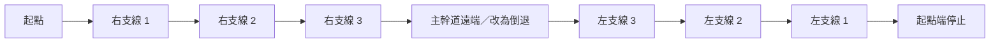

# 先巡全部右支線，再巡全部左支線

這是新的獨立巡邏入口，沒有取代舊程式或修改 Xavier 的開機服務。

左右固定以起點朝向為準。假設路口由起點至遠端依序為 1、2、3：

```text
起點 → 右1 → 右2 → 右3 → 主幹道遠端
起點端停止 ← 左1 ← 左2 ← 左3 ← 主幹道遠端
```



每個支線先前進至端點，再倒退回原路口；每次返回主幹道都朝原來的起點朝向。
第一輪沿主幹道前進；第二輪沿主幹道倒退，因此第二輪的實際路口順序為 3、2、1。
支線本身兩輪都以前進進入、倒退返回，不在狹窄支線掉頭。
這裡的「回到起點端」是雷達確認主幹道端牆後停止，並非精準回到原始座標。
新設定的巡航速度為 0.20 m/s，與三模式 AUTO 輸出上限一致；舊設定的速度不變。

## 檔案

| 新檔案 | 用途 |
| --- | --- |
| `lidar_patrol_right_then_left.py` | 新路線的純雷達控制器 |
| `fsm_right_then_left.py` | 新路線 ROS 節點，保留雷達監控、障礙保護與豬臉停止介面 |
| `control_modes_right_then_left.py` | 新路線 AUTO／MANUAL／STOP 入口，預設 STOP |
| `patrol_config_right_then_left.json` | 獨立設定；`junctions` 為每側需要巡的路口數 |

舊的 `lidar_patrol_controller.py`、`fsm_lidar_patrol.py`、`control_modes.py` 與
`patrol_config.json` 保留原本路線。新增控制器沿用原演算法的幾何與保護程式副本，
不會修改舊入口的路線。內部沿用 `LEFT_OUTBOUND` 等歷史狀態名稱，實際巡邏側以
`route_pass`（RIGHT／LEFT）和 `side_endpoints` 判斷。

## 本機測試

```bash
source /opt/ros/humble/setup.bash  # 本機標準 Humble；Xavier 使用自己的 underlay 路徑
python3 -m unittest discover -s rl_pig_pen/tests -p 'test_right_then_left*.py' -v
```

測試使用 `worlds/pig_pen_16units.world` 的靜態碰撞幾何作雷達射線投射，再以理想運動學
更新車體測試位置。世界中有三個雙側路口，新設定檔因此預設 `junctions=3`；舊設定檔
保留原值。實車若每側五個路口，可啟動時加 `-p junctions:=5`，須先核對場地。
控制器只接收雷達特徵與時間戳，
不接收測試世界的位置、odom、IMU 或速度積分。

檢查完整順序、六個實際支線端點位置、返回起點端、偏移起步、節點看門狗的煞車時間、
障礙保護、重複雷達時間戳及提早遇到主幹道端牆的失敗處理。
這不是 Gazebo 物理測試，也不代表已完成 Xavier 延遲或實車驗證。

### 本機驗證結果（2026-11-12）

共 15 項檢查通過：新控制器 10 項、三模式適配 4 項、舊路線完整回歸 1 項。

| 完整場景測試 | 結果 |
| --- | --- |
| 新設定 0.20 m/s，正常起步 | 右側三端點全部完成後，才訪問左側三端點，最後返回起點端 |
| 起步橫向偏移 6 cm、偏航 0.05 rad，從第一路口前起步 | 完成相同側別與順序 |
| 安全煞車計算使用 0.5 秒反應時間 | 完成相同側別與順序 |
| 舊控制器完整三路口、六端點路線 | 原本逐路口左右巡邏順序維持不變 |

完整場景以測試車體位置獨立核對右側端點在主幹道右邊、左側端點在左邊，且右側路口
順序遞增、左側遞減；不是只檢查程式輸出的計數。每幀檢查雷達碰撞範圍與主幹道速度
方向。其餘測試涵蓋外部暫停、前後障礙、持續接觸等待、時間戳異常、提早遇到端牆、
模式啟動、手控接管、雙側進度重設與狀態發布。

舊路線完整回歸指令：

```bash
PYTHONPATH="rl_pig_pen:rl_pig_pen/tests:${PYTHONPATH:-}" \
python3 -m unittest test_lidar_patrol.LidarPatrolTests.test_full_three_junction_six_endpoint_route -v
```

## 手動選擇新入口（尚未部署）

在已準備 ROS 環境的容器中，停止舊巡邏控制節點後，才可啟動以下其中一個入口。
兩個入口均使用正式 `/cmd_vel`；不能與舊節點同時運行。

```bash
# 三模式入口：先 STOP，之後使用既有 /control/set_mode 切換。
python3 /workspace/pig_patrol/rl_pig_pen/control_modes_right_then_left.py \
  --ros-args -p initial_mode:=STOP -r /scan:=/x10/scan

# 單純自動入口：感測與保護條件成立後即開始新巡邏。
python3 /workspace/pig_patrol/rl_pig_pen/fsm_right_then_left.py \
  --ros-args -r /scan:=/x10/scan
```

啟動雷達及 UART 需沿用實車環境的配置；新入口本身不啟動或重啟共用容器。
三模式入口保留現有手控設定（預設略過光達、線速上限 2.0 m/s），AUTO 則仍有光達保護、
線速上限 0.20 m/s。新路線尚未驗證實車，不應因理想運動學測試成功就提高 AUTO 速度。
手控接管會使新路線失效，須由操作者將車放回起點方向、STOP 下重設任務後才可重新 AUTO；
重設會同時清除左右側進度。

### Gazebo 支線進入修正（2026-11-12）

0.4 m/s 測試完成右側三支線及左側第一支線後，在左側第二支線的
`WALL_CONFIRM` 停住：當前牆面航向誤差約 6 度，超過 5 度確認門檻。
修正為牆面對有效、橫向偏移合格且航向誤差不超過 20 度時，允許
原地對正（角速度最多 0.15 rad/s），仍經過完整障礙檢查；確認門檻不變。
失去牆面或偏移超限仍停車。

新增回歸測試通過，並在 Gazebo 原卡點以已觀察的巡邏計數續測，確認
`ROTATING → FORWARD → LEFT_OUTBOUND`。這是卡點續測，尚非修改後從起點
完成六支線的驗證。模擬直行可用 `-p cruise_speed:=0.4 -p max_linear:=0.4`；
預設速度維持 0.2 m/s，舊巡邏程式不變。

### 含路口鐵柱重測（2026-11-12）

地圖新增 12 支 0.04 × 0.08 × 0.83 m 鐵柱後，重跑以下測試：

- 靜態雷達、理想運動：0.2 m/s 完整六支線通過（156.454 秒）。
- 靜態雷達、理想運動：0.4 m/s、0.5 秒控制反應預算完整六支線通過
  （127.839 秒），含端點位置、順序及雷達足跡碰撞檢查。
- Gazebo：從起點全新啟動，0.4 m/s、世界目標倍率 2；截至本次記錄，
  已完成首條右支線並離開原路口，過程有雷達接收間隔暫停及一次
  `turn_centre_drift`，均自動恢復。其餘路口尚在測試，不能視為整趟通過。

本次沒有更動巡邏或安全參數。既有車身固定角度雷達遮罩仍啟用，
測試結果僅適用目前設定；不能據此排除實車鐵柱、定位、車身尺寸與
雷達安裝差異造成的問題。未新增遮罩以隱藏地圖中的路口鐵柱。

Gazebo 日誌：`logs/env_47/iron_posts_patrol.log`；階段紀錄：
`logs/env_47/iron_posts_status.jsonl`；原始雷達與幾何診斷：
`logs/env_47/iron_posts_geometry/`。

### 角柱實際截面更新（2026-11-12）

經確認，角柱由兩個 4 × 4 cm 的 ㄇ 形槽鋼相連，外尺寸仍為
4 cm（X）× 8 cm（Y）× 83 cm。靠近十字路口的槽鋼開口沿主幹道朝向
路口；另一個開口朝主幹道中央，四角依位置鏡射。鐵板厚度暫定 2 mm。
每支由六片具有碰撞與視覺幾何的鐵板構成，不再使用實心包圍盒，
使雷達可量到實際開口及內壁。

可用 `python3 scripts/update_junction_posts.py worlds/pig_pen_16units.world`
重新生成現有 12 支柱子的截面，保留其位置。外尺寸、開口與背板方向、
鏡射及視覺／碰撞一致性檢查通過。更新 Gazebo 前已停止原實心柱巡邏；
前述實心柱巡邏測試不能代表此開口模型已通過，需另行重跑。

### 雙 ㄇ 形角柱重測（2026-11-12）

新截面地圖在 0.4 m/s、control_dt=0.5 的完整靜態雷達／理想運動測試
通過（161.485 秒），涵蓋右三左三支線順序、端點位置及足跡碰撞檢查。
Gazebo 已從起點重新啟動（未恢復舊計數），記錄至
`logs/env_47/u_channel_patrol.log`、`u_channel_status.jsonl` 與
`u_channel_geometry/`。截至本次記錄已辨識第一路口、進入 CENTER；實際
RTF 約 0.21，頻繁觸發 scan_receive_gap，均自行恢復。完整 Gazebo 尚未
完成，不能把靜態通過當作粗糙地面或完整物理模擬驗證。

### 實車待驗證的門檻試調（2026-11-12）

筆電端 `patrol_config.json` 與 `patrol_config_right_then_left.json` 明確設定
`junction_min_confidence=0.60`（原沿用 Config 預設 0.65）、
`junction_centre_tolerance=0.07`（原 0.05 m）。0.60 是幾何評分門檻，
不是成功機率；四向開口、牆面支撐、連續三掃描、碰撞檢查與轉彎中
0.15 m 偏移保護均未更動。新設定須複製至實車並由新程序載入，
不是即時參數更新。本次沒有重啟實車或正在運行的模擬巡邏。

占用開口、防碰撞、重複掃描三項現有測試通過；獨立的平行牆／無回波
負例在新門檻下仍被拒絕。既有 `test_parallel_walls_alone_or_no_returns_cannot_track`
在新角柱地圖的前置取樣點 (0,-6.764,pi/2) 無法取得路口；回復原
0.65／0.05 門檻亦相同，不能宣稱完整測試全數通過。完整巡邏及實車
誤判／旋轉可靠性仍待驗證。
